  
  
  
  

---

## 👋 About me

I help businesses turn ideas into **websites, online stores, SaaS platforms, and apps** that look premium, load fast, and turn visitors into customers.

With **4+ years of experience** and a background **leading a web development team**, I handle the full journey myself — strategy, UI/UX design, development, and launch — for clients across **Saudi Arabia, Egypt, the USA, and Europe**.

- 🎯 One partner for design, development, and launch
- 🌍 Bilingual (Arabic / English) and RTL experience
- ⚡ Performance, SEO, and clean, maintainable code by default
- 💼 Open to freelance projects and remote roles

---

## 🛠️ What I do

| Service | What you get |
|---|---|
| 🌐 **Web Development** | Custom websites and web applications, from landing pages to full platforms |
| 🧩 **SaaS, CRM & Dashboards** | Business systems with authentication, analytics, and real workflows |
| 🛒 **E-commerce** | Stores built to sell, with custom themes, catalogs, and payments |
| 📱 **Mobile & Desktop Apps** | Cross-platform apps with smooth, native-feeling experiences |
| 🎨 **UI/UX Design** | Wireframes, prototypes, and polished interfaces |
| ✨ **Branding & Content** | Brand identity, social media design, and video editing |
| 🚀 **SEO & Speed** | Technical SEO and performance optimization |

---

## ⭐ Featured work

### Open-source showcases

| Project | What it is | Links |
|---|---|---|
| **Nexora** | A complete, fully interactive SaaS for creative studios: landing page, auth, projects, clients, invoices, messages, calendar, analytics, and team, with motion everywhere | [Live demo](https://mohamed-mohsen2003.github.io/Mohamedsaas/) · [Code](https://github.com/Mohamed-Mohsen2003/Mohamedsaas) |
| **Personal portfolio** | My portfolio site with project filtering, light/dark themes, and smooth animations | [Live](https://mohamed-mohsen2003.github.io/mohamed-mohsen-portfolio/) · [Code](https://github.com/Mohamed-Mohsen2003/mohamed-mohsen-portfolio) |
| **Digital invitations** | Animated, mobile-first invitation websites with music, countdowns, and Arabic/English versions | Available on request |

### Client work

| Client | Project | My role |
|---|---|---|
| [Final SA](https://final.sa/) | Photography equipment rental platform · Saudi Arabia | UI/UX, front-end, SEO |
| [Tesla Developments](https://tesladevelopments.com/) | Bilingual real estate website · Egypt | UI/UX, front-end, SEO |
| [AZM Alsafwa Trading](https://azzeem.com/) | Corporate website · Saudi Arabia | Front-end, SEO |
| [Maharah](https://maharah.com/) | HR & recruitment corporate website · Saudi Arabia | Front-end, UI/UX, SEO |
| [Beamer](https://beamerint.com/) | Lighting company website & product catalog · Jeddah | Development, UI/UX, SEO |
| [Etlala Watches](https://etlala-watches.com/) | E-commerce store · Egypt | Store setup & customization |
| [New Zone](https://newzoneeg.com/) | Bilingual interior design website · Egypt | Development, UI/UX |

More projects in my <a href="https://mohamed-mohsen2003.github.io/mohamed-mohsen-portfolio/">portfolio</a>.

---

## 💼 Experience

| Role | Company | Period |
|---|---|---|
| **Web Developer** (Remote) | Auto Media Marketing Agency | Oct 2024 – Present |
| **Web Development Team Leader** | Vision 22 Marketing Agency | Mar 2024 – Mar 2026 |
| **Web Developer & UI/UX Designer** | Global Results Outsourcing | Jul 2022 – Nov 2023 |
| **Web Developer Intern** (React) | Egyptian General Petroleum Corporation (EGPC) | Jan 2022 – Mar 2022 |

🎓 **B.Sc. Management Information Systems** — Modern Academy for Computer Science and Management Technology (2021 – 2025)

---

## 🧰 Tech stack

**Front-end**

**Back-end & data**

**Mobile, CMS & e-commerce**

 

**Design & tools**

---

### 🤝 Let's build something great

Have a project in mind? [Message me on Upwork](https://www.upwork.com/freelancers/~018ad82f220b0969e6) or [send an email](mailto:mohamedmohsen.webdeveloper@gmail.com), and I'll reply with a clear plan and timeline.

